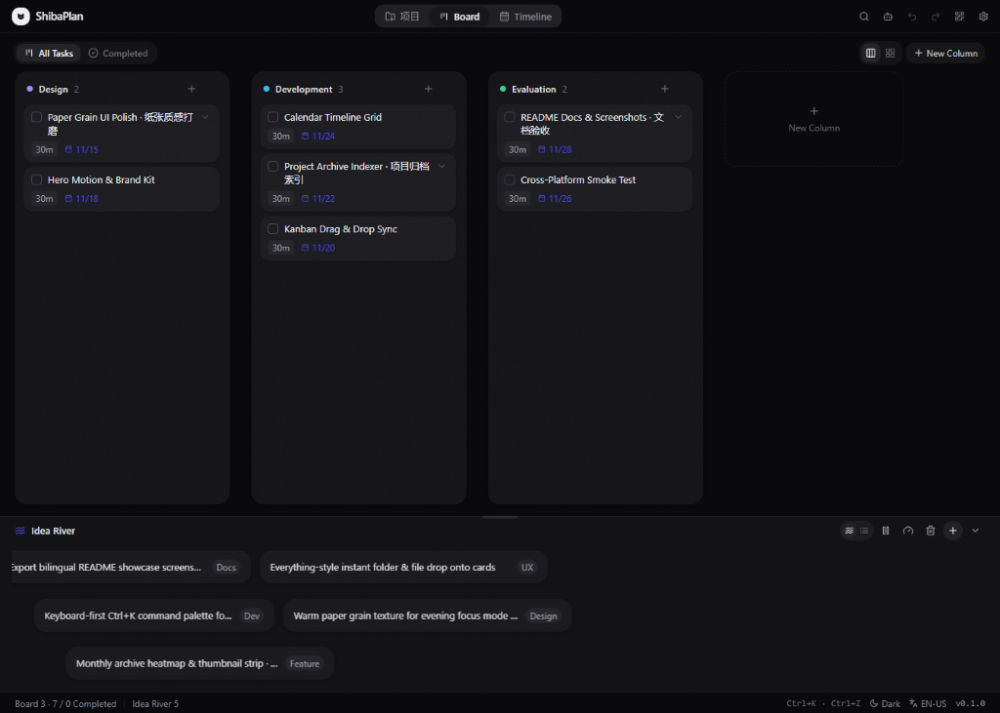
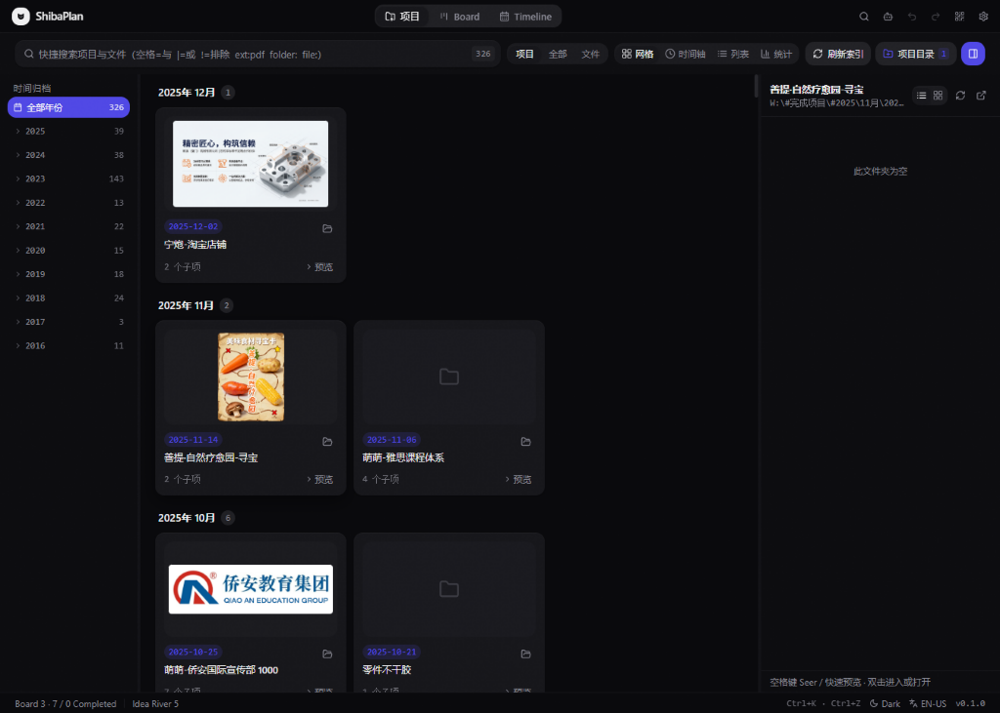
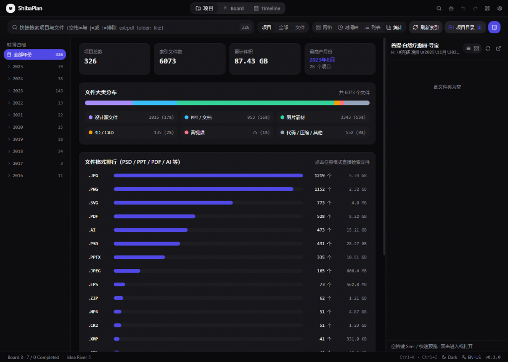
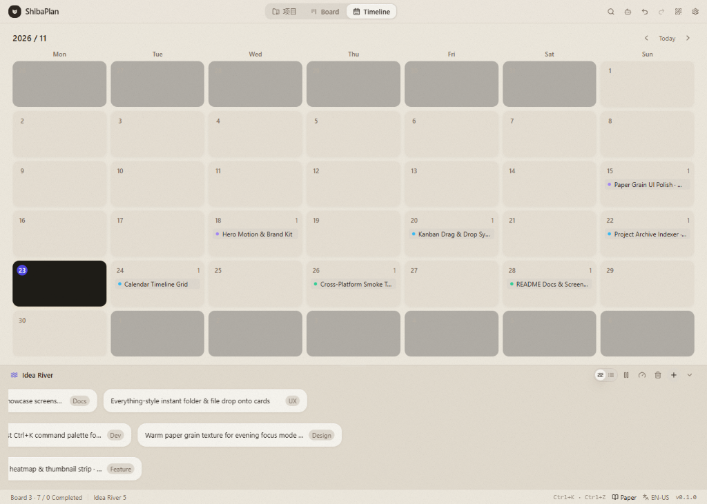
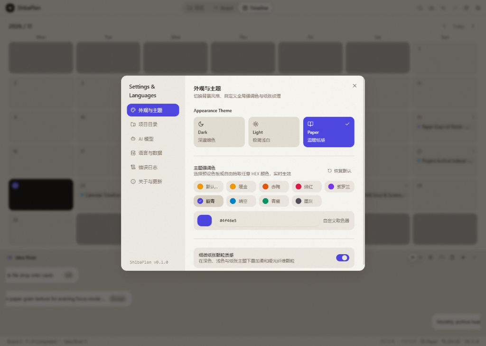

<div align="center">
  
  <h1>ShibaPlan</h1>
  <p><strong>A calm, local-first desktop workspace for Design, Development &amp; Evaluation.</strong></p>
  <p>
    Built with Tauri 2.0, React, TypeScript, Tailwind CSS &amp; shadcn/ui.<br />
    Frameless native performance · Zero cloud lock-in · Instant Everything-style archive search.
  </p>

  <p>
    <strong>English</strong> &nbsp;|&nbsp; <a href="./README.zh-CN.md">简体中文</a>
  </p>

  <p>
    
    
    
    
    
  </p>
</div>

---

## Interface Showcase

### Kanban Board &amp; Idea River (Dark Theme)


### Projects Archive, Statistics, Calendar &amp; Tabbed Settings
<table>
  <tr>
    <td width="50%">
      
      <p align="center"><sub><strong>Projects 3-Column Archive</strong> — Multi-folder cache, uncropped thumbnails, embedded explorer &amp; Seer Spacebar preview</sub></p>
    </td>
    <td width="50%">
      
      <p align="center"><sub><strong>File Statistics &amp; Output Trends</strong> — PSD / PPT / PDF / AI breakdown and yearly/monthly charts</sub></p>
    </td>
  </tr>
  <tr>
    <td width="50%">
      
      <p align="center"><sub><strong>Calendar &amp; Timeline (Paper Theme)</strong> — Fine tactile paper grain, mouse wheel month switch &amp; drag scheduling</sub></p>
    </td>
    <td width="50%">
      
      <p align="center"><sub><strong>Tabbed Settings</strong> — Custom HEX accent color, AI model auto-fetch, project directories &amp; diagnostic logs</sub></p>
    </td>
  </tr>
</table>

---

## Key Features

### 1. Three-Column Projects Archive &amp; Everything-Style Search
- **Multi-Folder Auto-Indexing &amp; Disk Cache**: Add multiple local archive folders (such as `W:\#CompletedProjects`) via the native OS folder picker. Directory structures, dates, and thumbnail paths are persisted in `project_archive_cache.json` for instant cold startup and zero-lag tab switching.
- **Smart Real-Date Inference**: Parses diverse date naming conventions (`2025-10-10_Name`, `25-02-19`, `20210913`, `0103`, `#2025/10月`, etc.) and supports **weighted month-cluster consensus** across inner deliverable files (`.psd`, `.ai`, `.pptx`, `.pdf`, `.stl`, `.dwg`, etc.) to recover true project completion dates even after folder migration.
- **Everything-Style Instant Search**: Supports space-separated `AND`, `|` (`OR`), `!` (`NOT`), `ext:psd;pptx;pdf`, `folder:`, `file:`, `year:2025`, and `*` / `?` wildcards with live keyword highlighting.
- **Four Views + Zoom**: Switch between **Grid** (uniform card height, max-width capped, `Ctrl + Wheel` zoom), **Timeline**, **List**, and **Statistics** (file category stacked bar, clickable Top-15 extension rankings, and yearly/monthly output charts).
- **Embedded Right Explorer &amp; Seer Spacebar Preview**: Resizable 3-column layout with List/Icon toggle inside the right file explorer. Press `Space` on any file to invoke **Seer** via its official Win32 `WM_COPYDATA` (`SEER_INVOKE_W32 = 5000`) protocol, with an automatic built-in QuickLook fallback.

### 2. Custom Kanban Board &amp; Freeform Canvas
- **Flexible Workflow**: Create custom columns, drag-reorder columns &amp; cards with precision insertion guides, drag-resize column widths and gaps, or double-click headers to collapse columns into folder-style summary tiles.
- **Freeform Canvas Mode**: Dot-grid canvas with direct wheel zoom, `Space + Drag` pan, magnetic alignment guides, one-click tidy grid, and fit-to-screen.
- **Native File &amp; Folder Shortcuts**: Drag files or folders directly from OS Explorer onto any column to create expandable folder cards; hover and press `Ctrl + V` to paste text or screenshots directly.

### 3. Idea River &amp; Global Quick Capture
- **Drifting Idea Dock**: Multi-row non-looping idea stream with wheel horizontal scroll, resizable height, paginated List view, Recycle Bin, and double-click title bar to collapse/expand.
- **Global Shortcut Capture**: Press `Alt + Space` (auto-fallback `Ctrl + Shift + Space`) from anywhere on your desktop to capture ideas or screenshots without breaking flow.
- **Bidirectional Drag**: Drag ideas onto Kanban columns or Calendar dates (`Alt` to copy), or export structured Markdown specs for AI coding assistants.

### 4. Calendar &amp; Timeline
- Monthly grid with mouse wheel month switching, hover day previews, drag-and-drop scheduling from Idea River, and cross-day rescheduling.

### 5. Multi-Provider AI &amp; LAN Mobile Sync
- **Multi-Provider AI Presets**: Built-in presets for Zhipu GLM, DeepSeek, Qwen, Kimi, Gemini, OpenAI, OpenRouter, and local Ollama, with **one-click automatic model list fetching** and connection testing.
- **LAN Access &amp; Mobile QR Code**: Built-in zero-dependency Rust HTTP server (`:18420`) with offline QR code generation. Scan with your phone on the same Wi-Fi to view and live-sync your workspace.

### 6. Native Desktop Polish
- **Frameless Custom Titlebar**: Native Windows drop shadow, drag-to-move, double-click maximize/restore, minimize to system tray, and single-instance wake protection.
- **Themes, Custom Accent &amp; Typography**: Dark, Light, and Warm Paper themes with toggleable fine paper grain, custom HEX accent color picker, and a clean 12px+ typographic hierarchy.
- **Persistent Diagnostics &amp; Online Updates**: Automatic Rust panic hook + React ErrorBoundary + rotating `logs/shibaplan.log` viewer inside Settings, plus GitHub Releases update checker.

---

## Keyboard Shortcuts

| Shortcut | Action |
| :--- | :--- |
| `Ctrl + K` | Open Global Command Palette &amp; Search |
| `Alt + Space` / `Ctrl + Shift + Space` | Global Quick Capture window |
| `Ctrl + Z` / `Ctrl + Shift + Z` | Undo / Redo (30-step history) |
| `/` or `Ctrl + F` (Projects) | Focus Everything-style archive search |
| `Space` (Projects Explorer) | Trigger Seer / QuickLook preview |
| `Ctrl + Wheel` (Projects Grid) | Zoom project card size |
| `Esc` | Close lightbox, QuickLook, or dialogs |

---

## Development &amp; Build

### Prerequisites
- Node.js 20+
- Rust 1.80+ (with MSVC Build Tools on Windows or Xcode CLT on macOS)

### Run Locally
```bash
npm install
npm run tauri dev
```

### Build Desktop Installers
```bash
npm run tauri build
```

Artifacts are generated in `src-tauri/target/release/` (portable executable) and `src-tauri/target/release/bundle/` (NSIS `.exe` / `.msi` / `.dmg`). Pushing a `v*` git tag automatically triggers multi-platform GitHub Actions release builds.

---

## License

MIT License.
