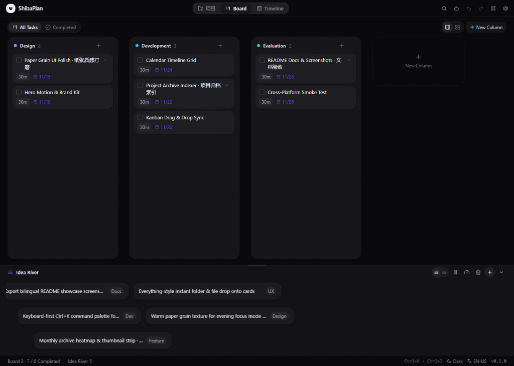
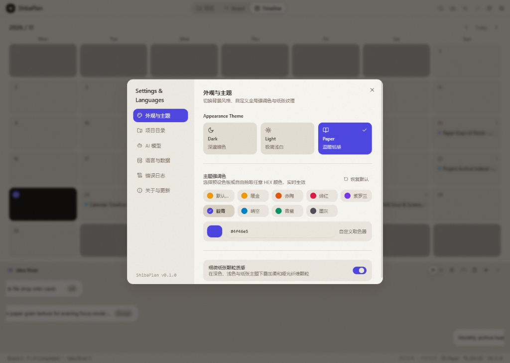

<div align="center">
  
  <h1>ShibaPlan</h1>
  <p><strong>克制、本地优先的个人工作台，面向设计、开发与评测工作流。</strong></p>
  <p>
    基于 Tauri 2.0、React、TypeScript、Tailwind CSS 与 shadcn/ui 构建。<br />
    无边框原生体验 · 数据完全本地掌控 · Everything 级过往项目索引与检索。
  </p>

  <p>
    <a href="./README.md">English</a> &nbsp;|&nbsp; <strong>简体中文</strong> &nbsp;|&nbsp; <a href="https://wonvy.github.io/ShibaPlan/">在线说明文档</a> &nbsp;|&nbsp; <a href="https://wonvy.github.io/ShibaPlan/api/overview.html">接口与协议参考</a>
  </p>

  <p>
    
    
    
    
    
  </p>
</div>

---

## 界面预览

### 看板与灵感流（深色主题）


### 过往项目归档、文件统计、纸感日历与选项卡设置
<table>
  <tr>
    <td width="50%">
      
      <p align="center"><sub><strong>项目三栏归档</strong> — 多目录本地缓存、原比例不裁剪缩略图、右侧资源管理器与 Seer 空格预览</sub></p>
    </td>
    <td width="50%">
      
      <p align="center"><sub><strong>文件统计与产出趋势</strong> — PSD / PPT / PDF / AI 格式排行、大类占比与历年/月度柱状图</sub></p>
    </td>
  </tr>
  <tr>
    <td width="50%">
      
      <p align="center"><sub><strong>时间日历（纸张主题）</strong> — 细微纸张纤维颗粒质感、滚轮切月与拖拽排期</sub></p>
    </td>
    <td width="50%">
      
      <p align="center"><sub><strong>选项卡式设置</strong> — 自定义 HEX 主题色、AI 模型自动获取、项目目录管理与错误日志</sub></p>
    </td>
  </tr>
</table>

---

## 核心特性

### 1. 三栏过往项目归档与 Everything 快捷搜索
- **多目录自动索引与本地缓存**：在“设置 → 项目目录”中通过系统原生文件夹选择器添加多个归档目录，目录结构、解析日期与缩略图路径自动缓存至 `project_archive_cache.json`，冷启动与切换标签零延迟。
- **多种日期兼容与真实完成日期推断**：兼容 `2025-10-10_名称`、`25-02-19`、`20210913`、`0103`、`#2025/10月` 等格式；支持 **项目内交付文件加权月份聚类算法**，自动过滤旧模板与偶发误改，精准还原项目真实完成日期。
- **Everything 级秒搜**：支持空格（与）、`|`（或）、`!`（排除）、`ext:psd;pptx;pdf`、`folder:`、`file:`、`year:2025` 与 `*`/`?` 通配符搜索及关键词高亮。
- **四种视图 + 缩放**：支持 **网格**（统一等高、限制最大宽度、`Ctrl + 滚轮` 缩放）、**时间轴**、**列表** 与 **统计图表**（点击任意格式条可直接下钻检索对应文件）。
- **可调宽三栏 + 右侧资源管理器 + Seer 空格预览**：左右三栏均可拖拽调宽并记忆；右侧资源管理器支持列表/图标切换，选中文件按 **空格键** 通过 Seer 官方 Win32 `WM_COPYDATA (5000)` 协议原生预览（未安装 Seer 时自动启用内置快速预览）。

### 2. 自定义看板与自由画布
- **灵活列管理**：自由新建列、拖拽排序并带精准插入线、单列拖拽调宽与列间距调节、双击列标题折叠为文件夹统计卡片。
- **自由画布模式**：支持点阵画布、滚轮缩放、`Space + 拖拽` 平移、智能对齐辅助线、一键整理与适配屏幕。
- **系统文件/文件夹快捷方式**：直接从资源管理器拖入文件或文件夹生成可展开卡片；悬停按 `Ctrl + V` 直接粘贴文本或截图。

### 3. 灵感流与全局闪念记录
- **多轨漂流灵感坞**：支持滚轮横向滚动、拖拽调整高度、分页列表模式、回收站，以及双击“灵感流”标题快速折叠/展开。
- **全局快捷键闪念**：任意界面按 `Alt + Space`（冲突时自动回退 `Ctrl + Shift + Space`）快速记录灵感与截图。
- **双向拖拽与 AI 规范导出**：支持灵感与看板/日历双向拖拽（按住 `Alt` 复制），一键导出结构化 Markdown 提示词。

### 4. 时间日历视图
- 支持鼠标滚轮平滑切换月份、单日悬浮预览、从灵感流拖入排期与跨天改期。

### 5. 多平台 AI 与局域网手机扫码同步
- **多平台 AI 预设与模型自动获取**：内置智谱 GLM、DeepSeek、通义千问、Kimi、Gemini、OpenAI、OpenRouter 与本地 Ollama 预设，支持一键拉取服务端可用模型列表与连通性测试。
- **局域网手机扫码访问**：桌面端内置轻量 Rust HTTP 服务（默认端口 `18420`），离线生成二维码，同一 Wi-Fi 下手机扫码即可直接打开并与电脑实时同步。

### 6. 桌面端原生细节打磨
- **无边框自定义标题栏**：保留 Windows 原生阴影与缩放，支持标题栏拖动、双击最大化/还原、关闭隐藏至托盘与单实例唤醒保护。
- **主题、自定义主题色与可读性**：内置深色、浅色、纸张 3 套主题与可开关细微纸张颗粒，支持自由取色自定义主题强调色，全界面最小字号 `12px` 并具备清晰层级。
- **持久化错误日志与在线更新**：集成 Rust 原生崩溃钩子、React 错误边界与自动轮转日志文件（`logs/shibaplan.log`），支持在设置中一键查看/复制日志，并支持 GitHub Releases 在线检测更新。

---

## 常用快捷键

| 快捷键 | 功能 |
| :--- | :--- |
| `Ctrl + K` | 全局搜索与命令面板 |
| `Alt + Space` / `Ctrl + Shift + Space` | 全局快速记录灵感 |
| `Ctrl + Z` / `Ctrl + Shift + Z` | 撤销 / 重做（30 步历史） |
| `/` 或 `Ctrl + F`（项目页） | 聚焦 Everything 快捷搜索框 |
| `Space`（右侧资源管理器） | 唤起 Seer / 内置快速预览 |
| `Ctrl + 滚轮`（项目网格） | 缩放项目卡片尺寸 |
| `Esc` | 关闭大图灯箱、预览窗或弹窗 |

---

## 开发与构建

### 环境要求
- Node.js 20+
- Rust 1.80+（Windows 需 MSVC Build Tools，macOS 需 Xcode CLT）

### 本地启动
```bash
npm install
npm run tauri dev
```

### 打包桌面客户端
```bash
npm run tauri build
```

生成产物位于 `src-tauri/target/release/`（免安装绿色版）与 `src-tauri/target/release/bundle/`（NSIS `.exe` / `.msi` / `.dmg`）。推送 `v*` 标签后 GitHub Actions 将自动构建并发布多平台安装包。

---

## 开源协议

MIT License。
