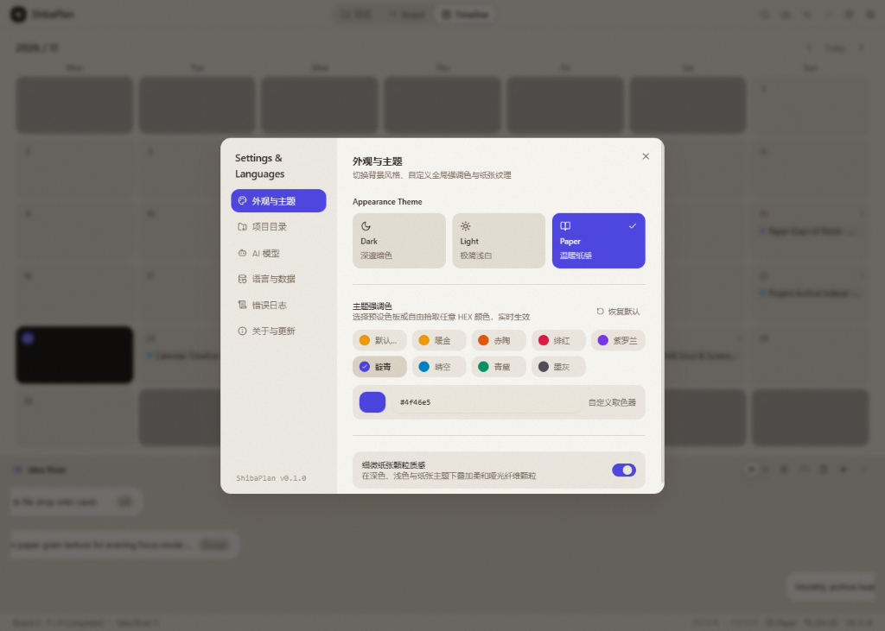

# AI, LAN Sync & Customization

---

## 1. Multi-Provider AI & Daily Planning

Open **Settings → AI Model**. ShibaPlan includes built-in presets for major LLM providers and **remembers separate API keys and selected models per provider**:

- **Built-in Providers**: OpenAI, Google Gemini (OpenAI-compatible endpoint), OpenRouter, DeepSeek, Zhipu GLM, Qwen (DashScope), Kimi (Moonshot), and local keyless **Ollama** (`http://127.0.0.1:11434/v1`).
- **Smart Key Detection**: Pasting an API key automatically detects matching providers and switches presets without overwriting saved credentials on other platforms.
- **Fetch Models & Test Connection**: Pull available model IDs straight from `/models` and verify connectivity with one click.
- **AI Today's Plan**: Click the robot icon in the top bar (or run **AI Today's Plan** from `Ctrl + K`) to generate a prioritized schedule based on task urgency, effort estimates, and due dates.

---

## 2. LAN Mobile QR Sync (Default Port `18420`)

Review tasks or capture ideas from your phone over Wi-Fi without cloud accounts:

1. Click the **QR Code icon** in the top-right header bar.
2. Start the LAN Server (default port `18420`; automatically prioritizes physical Wi-Fi / Ethernet adapters ahead of WSL, Docker, or Hyper-V virtual interfaces, with a dropdown selector for multi-NIC machines).
3. Scan the offline-generated QR code with your phone camera on the same Wi-Fi network.
4. Edits made on mobile sync back to `shibaplan-data.json` and update the desktop UI immediately.

> If your phone cannot reach the URL, ensure your OS firewall allows inbound TCP traffic on port `18420` for private networks.

---

## 3. Themes, Custom Accent Colors & Localization

### Three Themes + Custom HEX Accent
- Switch between **Dark**, **Light**, and warm **Paper** themes, with independent toggles for subtle paper grain texture and Idea River ambient glow.
- Pick from 10 curated color swatches or enter any custom `#RRGGBB` hex value for live global accent theming.

### Built-in English / Chinese & Custom Locale Packs
- Switch between **English (`en-US`)** and **简体中文 (`zh-CN`)** anytime under **Settings → Language & Data**.
- Click **Export Language JSON** to download a complete translation template (`shibaplan-lang-*.json`), translate it into any language, and click **Import Language JSON** to apply it immediately.

---

## 4. Keyboard Shortcuts Reference

| Shortcut | Scope | Action |
| :--- | :--- | :--- |
| `Ctrl + K` | App-wide | Open global search & Command Palette (tasks, memos, info cards, ideas, trash, actions) |
| `Alt + Space` | System-wide | Summon / hide Global Quick Capture window (falls back to `Ctrl + Shift + Space` if occupied) |
| `Ctrl + Z` | App-wide | Undo last workspace change (up to 30 snapshots) |
| `Ctrl + Shift + Z` | App-wide | Redo undone workspace change |
| `Ctrl + V` | Hover column / Idea River | Paste clipboard image or text directly into a column or Idea River |
| `/` or `Ctrl + F` | Projects View | Focus Everything-style instant search input |
| `Space` | Projects Explorer pane | Preview selected file via Seer or built-in quick preview |
| `Ctrl + Wheel` | Projects Grid View | Zoom project card thumbnail size |
| `Space + Left-Drag` | Board Free Canvas | Pan around the freeform canvas |
| `Esc` | Dialogs / Previews | Close active lightbox, preview, capture window, or modal |

---

## 5. Troubleshooting & Diagnostic Logs

1. Open **Settings → Error Logs** to inspect frontend exceptions, unhandled Promise rejections, and Rust panic hooks, filter **Errors Only**, copy logs, or open `logs/shibaplan.log` on disk (rotates automatically at `2MB`).
2. To recover from accidental bulk edits beyond undo history, go to **Settings → Language & Data → Automatic Daily Snapshots** to restore any of the past 7 daily workspace backups in one click.
