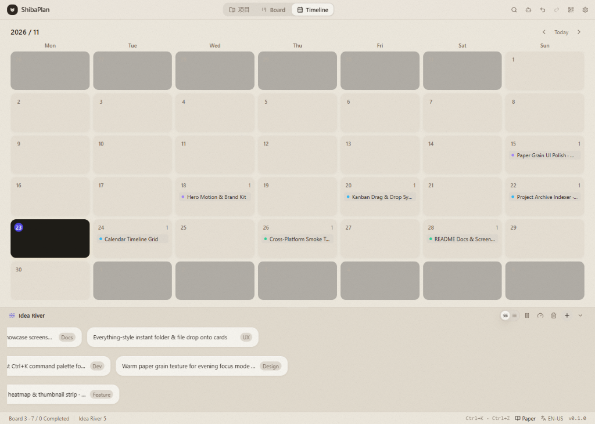

# Timeline Calendar & Memos

## Timeline Calendar View

The **Timeline** view maps scheduled board tasks and expiring memos onto a clean monthly grid so you can balance workload across weeks at a glance.

### Key Interactions
- **Smooth Wheel Month Navigation**: Scroll the mouse wheel over the calendar grid (or use the top-left arrows) to switch months; click **Today** to jump back to the current date.
- **Hover Preview & Quick Scheduling**: Hover over any day cell to preview all scheduled tasks and total estimated effort; click a day to create a task directly on that date.
- **Drag-and-Drop Rescheduling**:
  - Drag tasks between calendar days to reschedule;
  - Drag items from the **Unscheduled** sidebar or bottom **Idea River** onto any date cell.
- **Expiring Memo Markers**: Memos configured with an expiration date (`expiresAt`) appear alongside tasks on their due date.

---

## Structured Memos & Expiry Tracking

The **Memos** view is designed for reference notes and recurring renewals that do not belong on a short-term sprint board—such as CLI cheat sheets, server notes, SSL certificates, domain registrations, software subscriptions, and API quotas.

### 1. Folders, Pinning & Daily Notes
- Organize memos into collapsible folders in the left sidebar (`Servers & Certs`, `Subscriptions`, `Design Specs`, `Daily Notes`).
- **Pin** important memos to keep them anchored at the top of the list.
- Create date-stamped **Daily Notes** for lightweight journaling.

### 2. Expiration Alerts & One-Click Renewal
Every memo supports an optional **Expiration Date (`YYYY-MM-DD`)** and **Renewal Cycle (`30` / `90` / `365` days)**:
- **Multi-Level Visual Alerts**:
  - **Normal**: Displays remaining days calmly;
  - **Expiring Soon**: Lights up an amber indicator dot next to **Memos** in the top navigation bar;
  - **Urgent / Expired**: Highlights in rose-red and surfaces urgency badges in `Ctrl + K` search results.
- **Cycle Renewal**: After renewing a certificate or subscription, advance its expiration date by its configured cycle in one click.

### 3. Live Markdown & Instant Global Search
- Write memos in GitHub Flavored Markdown (headings, tables, task lists, fenced code blocks, links).
- Press `Ctrl + K` from anywhere in ShibaPlan to search memo titles, tags, and Markdown content and jump straight to the matching note.
