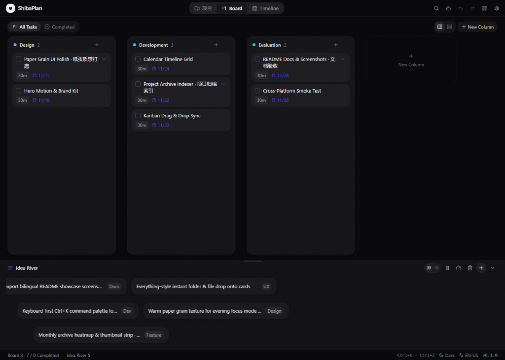

# Installation & Quickstart

**ShibaPlan** is a **local-first personal workspace** crafted for designers, developers, and hardware/software evaluators. Built on **Tauri 2.0 + React 18 + TypeScript**, it delivers a lightweight native experience while keeping all your tasks, ideas, memos, and scripts in plain local JSON and Markdown files.



---

## Supported Platforms & Installation

### 1. Prebuilt Desktop Installers

Download the latest installer for your OS from [GitHub Releases](https://github.com/Wonvy/ShibaPlan/releases):

| Platform | Formats | Highlights |
| :--- | :--- | :--- |
| **Windows 10 / 11 (x64)** | `.exe` (NSIS) / `.msi` | Native WebView2 file-drop path resolution & Seer `Space` preview integration |
| **macOS (Apple Silicon / Intel)** | `.dmg` / `.app.tar.gz` | Native file reveal and OS integration |
| **Linux (x64)** | `.AppImage` / `.deb` | File manager integration via `xdg-open` |

### 2. Build from Source

Prerequisites: **Node.js 20+** and **Rust 1.80+** (MSVC Build Tools on Windows, Xcode Command Line Tools on macOS):

```bash
git clone https://github.com/Wonvy/ShibaPlan.git
cd ShibaPlan
npm install

# Launch desktop dev mode (auto-builds offline docs on first run)
npm run tauri dev

# Build production installer (bundles bilingual offline docs automatically)
npm run tauri build
```

---

## Five Primary Workspace Views

The frameless top bar keeps five primary views centered, with Command Palette (`Ctrl + K`), AI Planner, Quick Capture, Undo/Redo, LAN QR Sync, Documentation, and Settings on the right:

1. **Projects**: 3-pane historical project archive with multi-folder indexing, Everything-style instant search, file format statistics, and an embedded file explorer.
2. **Board**: Custom Kanban columns and freeform dot canvas with native OS file/folder shortcut cards, focus timers, and priority stars.
3. **Timeline**: Monthly calendar view with hover previews, wheel month switching, and drag-and-drop scheduling from unscheduled tasks or the Idea River.
4. **Memos**: Folder-organized Markdown notes with expiration countdowns and one-click renewal for SSL certificates, domains, memberships, and servers.
5. **Info**: Programmable automation dashboard powered by local scripts, CLI commands, REST APIs, or external HTTP Webhooks.

::: tip System Tray & Single-Instance Protection
Clicking the top-right `×` button hides ShibaPlan to the system tray so your global Quick Capture shortcut (`Alt + Space`) and scheduled Info widgets remain active. Right-click the tray icon and choose **Quit** to exit completely.
:::

---

## Local Data Directory & Cloud Drive Sync

By default, ShibaPlan stores all workspace files under `~/Documents/ShibaPlan/` (`%USERPROFILE%\Documents\ShibaPlan\` on Windows):

```text
ShibaPlan/
├── shibaplan-data.json        # Core workspace state (columns, tasks, ideas, memos, info widgets, settings)
├── project_archive_cache.json # Cached index & thumbnails for archived project folders
├── backups/
│   └── workspace-YYYY-MM-DD.json  # Automatic daily snapshots (retains latest 7 days)
├── assets/
│   └── shot_*.png             # Pasted clipboard screenshots
├── ideas/
│   └── *.md                   # Exported Markdown idea prompts
├── scripts/                   # Managed scripts for the Info Dashboard
├── info-cache/
│   └── results.json           # Cached latest outputs for Info widgets
└── logs/
    └── shibaplan.log          # Rotating diagnostic & crash log (2MB cap)
```

### Multi-Device Sync (Windows + macOS)

Open **Settings → Language & Data** and point **Local Data & Markdown Sync Folder** to a folder inside **OneDrive, iCloud Drive, Syncthing, or a Git repository** for private cross-machine synchronization.

---

## Offline and Online Documentation

ShibaPlan ships with both **bundled offline documentation** and an **online documentation site**, with full **English / 简体中文** switching and instant full-text search:

- **Offline In-App Consultation (Zero Internet Required)**:
  - Click the **Documentation icon (`BookOpen`)** in the top-right header bar;
  - Press `Ctrl + K` and search `Docs`, `Documentation`, or `API`;
  - Click **Offline Docs** inside **Settings → About & Updates**, **Info Protocol Dialog**, or **Push Server Dialog**.
- **Online Documentation**: Visit `https://wonvy.github.io/ShibaPlan/en/` in any browser (or click **Online Docs** inside the app).
- **Mobile LAN Access**: When the LAN server (`:18420`) is active, open `http://<desktop-lan-ip>:18420/docs/en/index.html` from your phone browser.
