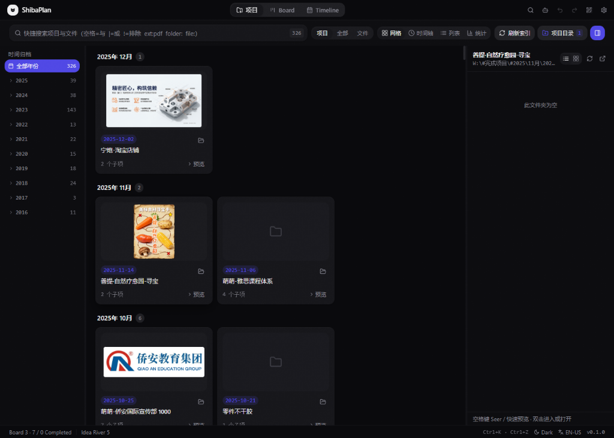
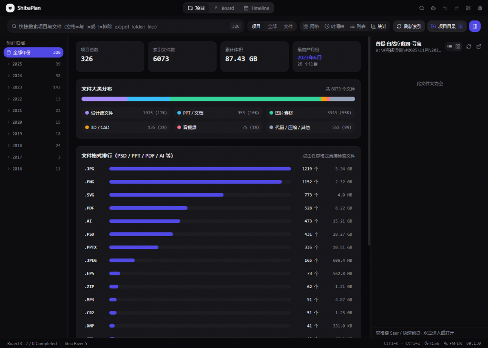

# Project Archive & Search

For creators and engineers who accumulate hundreds of historical design folders, CAD assemblies, codebases, and evaluation reports across drives, the **Projects** view provides a **non-destructive 3-pane archive and Everything-grade instant search engine**.

---

## 1. Multi-Folder Indexing & Incremental Cache

1. Open **Settings → Project Folders** and add one or more archive directories (local SSD/HDD folders, external drives, or mapped NAS shares, each with an optional display alias).
2. ShibaPlan scans directories across parallel worker threads, selects the best cover thumbnail, infers real completion dates, and caches the index in `project_archive_cache.json`.
3. **Subtree Signature Skipping**: Subsequent scans compare child counts, latest modification timestamps, and byte signatures so unchanged projects skip re-analysis for near-instant cold starts.

---

## 2. Smart Date Parsing & Real Completion Date Inference

Historical project folders rarely follow a single naming convention. ShibaPlan combines flexible prefix parsing with a **Weighted Month-Clustering Algorithm**:

- **Recognized Folder Naming Conventions**:
  - `2025-10-10_Packaging`, `2025.10.10 Launch`, `2025_10_10`
  - `20210913_KeyVisual` (8-digit `YYYYMMDD`)
  - `25-02-19 FirmwareTest`, `250219_RevB` (6-digit `YYMMDD`)
  - Context inheritance from parent year/month containers such as `#2025/10/0103_Redesign`.
- **Weighted Deliverable Clustering**:
  - When a folder lacks a date prefix—or its folder `mtime` was altered by copying old templates—ShibaPlan weights deliverable formats (`psd`, `ai`, `fig`, `blend`, `dwg`, `pptx`, `pdf`, `mp4`, `rs`, `ts`, etc. at `3x`, while ignoring `~$`, `tmp`, `bak` noise) by `(year, month)` buckets to pinpoint when the project was actually completed.
- Choose your preferred date priority in **Settings → Project Folders**: `Folder Name First`, `Deliverable Files First`, or `Folder Name Only`.

---

## 3. Everything-Style Search Syntax

Press `/` or `Ctrl + F` in the Projects view to focus the search bar with live keyword highlighting:

| Query Example | Meaning |
| :--- | :--- |
| `poster launch` | **AND**: Matches items containing both `poster` and `launch` |
| `kv \| banner` | **OR**: Matches either `kv` or `banner` |
| `!backup !old` | **NOT**: Excludes items containing `backup` or `old` |
| `ext:psd;ai;pdf` | **Extension Filter**: Matches one or more semicolon-separated file extensions |
| `folder:2025` | **Folders Only**: Restricts results to directories |
| `file:final` | **Files Only**: Searches individual deliverable files inside indexed roots |
| `year:2024` | **Year Filter**: Restricts results to projects dated in `2024` |
| `*eval?.pptx` | **Wildcards**: `*` matches any sequence, `?` matches a single character |

---

## 4. Four Views & Interactive Format Drill-Down

- **Grid View**: Preserves original aspect ratios without cropping; hold `Ctrl + Mouse Wheel` to zoom card size smoothly.
- **Timeline View**: Groups projects chronologically by year and month.
- **List View**: High-density table showing path, date source, file count, and size.
- **Stats View**: Ranks file formats (`PSD`, `PPTX`, `PDF`, `AI`, `CAD`, video, code) and plots yearly/monthly output histograms. **Click any format bar to drill down and search all matching files immediately.**

---

## 5. Embedded Explorer & Seer Spacebar Preview

All three panes in the Projects view can be resized by dragging their dividers:
- Selecting a project opens its live directory contents in the right-hand Explorer pane (toggle between list and icon grid, navigate subfolders, or reveal in OS Explorer/Finder).
- **Spacebar Quick Preview (`Space`)**:
  - On Windows with [Seer](http://1218.io/) installed, ShibaPlan invokes Seer's native Win32 `WM_COPYDATA (5000)` protocol to preview PSD, AI, CAD, Office, and video files instantaneously;
  - When Seer is not installed (or on macOS/Linux), ShibaPlan automatically opens its built-in high-resolution image lightbox or code/text preview dialog.
