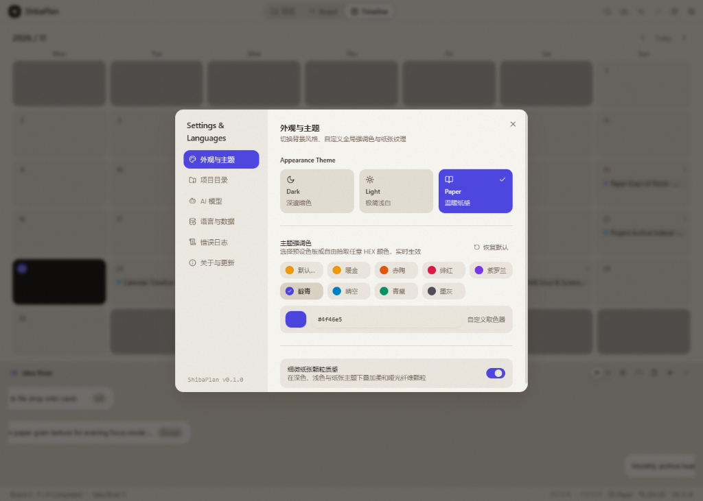

# AI、局域网同步与个性化

---

## 1. 多平台 AI 接入与智能排期

打开 **设置 → AI 模型**，ShibaPlan 内置主流大模型平台预设，且**每个平台独立记忆各自的 API Key 与所选模型**，来回切换无需重复填写：

- **内置预设平台**：智谱 GLM、DeepSeek、通义千问（DashScope）、Kimi（Moonshot）、Google Gemini（OpenAI 兼容接口）、OpenAI、OpenRouter，以及本地免 Key 的 **Ollama**（`http://127.0.0.1:11434/v1`）。
- **Key 格式智能识别**：粘贴 API Key 时可自动识别对应服务商并切换预设地址。
- **一键获取模型与连通测试**：点击「获取模型列表」实时拉取服务端可用模型下拉框，点击「测试连接」验证通过后自动保存配置。
- **AI 今日排期建议**：点击顶栏机器人图标（或在 `Ctrl + K` 中选择「AI 今日排期建议」），AI 将综合当前未完成任务的紧急度、预估耗时与截止日期生成今日行动顺序建议。

---

## 2. 局域网手机扫码实时同步（默认端口 `18420`）

出门到会议室、测试台或想在手机上快速勾选待办、补充灵感时，无需注册云账号：

1. 点击主窗口右上角 **二维码图标（局域网访问与手机扫码）**。
2. 点击启动局域网服务（默认端口 `18420`，支持多网卡自动优选真实 Wi-Fi / 以太网 IP，自动排后 WSL / Docker / VMware 等虚拟网卡，也可手动切换网卡下拉框）。
3. 手机连接同一局域网 Wi-Fi，使用相机或浏览器直接扫描屏幕上的离线二维码即可打开移动适配版工作台。
4. 手机端新增灵感或修改任务后，电脑端通过内部事件实时无感刷新。

> 若扫码后手机无法打开页面，请检查 Windows 防火墙是否放行了当前网络（专用网络）下 ShibaPlan 的入站端口 `18420`。

---

## 3. 外观主题、自定义强调色与多语言

### 三套质感主题 + 任意 HEX 强调色
- 内置 **深色（Dark）**、**浅色（Light）**、**纸张质感（Paper）** 三套主题，支持开关细微纸张纤维颗粒与底部灵感流氛围光效。
- 支持 10 款精选预设色板，或通过取色器输入任意 `#RRGGBB` 颜色实时全局替换主题强调色。

### 内置中英文与自定义语言包扩展
- 在 **设置 → 语言与数据** 中可随时切换 **简体中文（`zh-CN`）** 与 **English（`en-US`）**。
- 点击「导出语言文件」可下载完整词条 JSON（`shibaplan-lang-*.json`），翻译修改后点击「导入语言文件」即可添加日语、韩语、德语等任意自定义界面语言。

---

## 4. 全局快捷键速查表

| 快捷键 | 作用域 | 功能说明 |
| :--- | :--- | :--- |
| `Ctrl + K` | 应用全局 | 打开全局搜索与命令面板（检索任务、备忘、信息卡、灵感、回收站与快捷动作） |
| `Alt + Space` | 系统全局 | 唤起/隐藏全局闪念捕获浮窗（冲突时自动回退为 `Ctrl + Shift + Space`） |
| `Ctrl + Z` | 应用全局 | 撤销上一步工作区修改（最多保留 30 步） |
| `Ctrl + Shift + Z` | 应用全局 | 重做已撤销的操作 |
| `Ctrl + V` | 看板列 / 灵感流悬停 | 将剪贴板截图或文本直接粘贴为对应列任务或新灵感 |
| `/` 或 `Ctrl + F` | 项目归档页 | 聚焦顶部 Everything 高级搜索框 |
| `Space` | 项目右侧资源管理器 | 对选中文件唤起 Seer 原生预览或内置快速预览窗 |
| `Ctrl + 滚轮` | 项目网格视图 | 连续缩放项目缩略图卡片尺寸 |
| `Space + 左键拖拽` | 看板自由画布 | 平移自由画布视野 |
| `Esc` | 全局弹窗 / 预览窗 | 关闭当前灯箱预览、闪念窗或对话框 |

---

## 5. 故障排查与运行日志

遇到脚本报错、更新异常或路径读取问题时：
1. 打开 **设置 → 错误日志**，可一键过滤「仅错误」日志、复制日志全文，或点击「打开目录」查看本地 `logs/shibaplan.log`（超过 `2MB` 自动轮转为 `shibaplan.log.old`）。
2. 若误删重要看板列或卡片，除了按 `Ctrl + Z` 撤销外，还可前往 **设置 → 语言与数据 → 每日自动快照**，一键恢复最近 7 天内任意一天的完整工作区快照。
