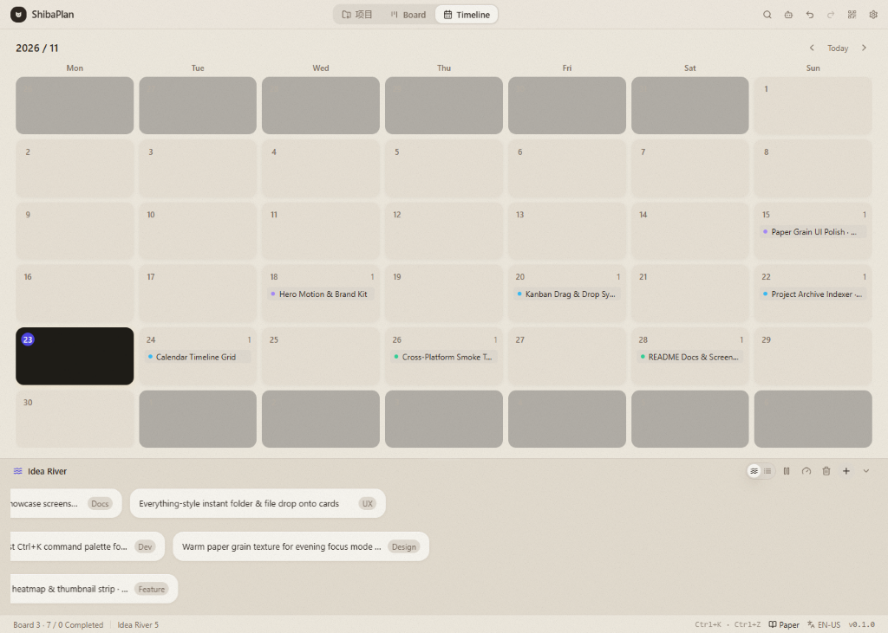

# 时间日历与备忘录

## 时间日历视图（Timeline Calendar）

时间视图将看板中的待办任务与备忘录中的到期事项统一映射在月历网格上，帮助你直观把控整月排期密度。

### 核心操作
- **滚轮平滑切月**：在月历区域滚动鼠标滚轮（或点击左上角上/下月按钮）快速切换月份，点击「今天」一键回到当月，同时内置中国农历与节气信息参考。
- **悬停预览与快速新建**：鼠标悬停任意日期即可浮窗预览当天全部任务与预估总工时；点击日期格子可直接为当天新建排期任务。
- **跨天拖拽改期**：
  - 将日历上的任务直接拖到另一天即可完成改期；
  - 从右侧「未排期任务池」或底部「灵感流」直接拖入任意日期格子，自动绑定日期。
- **到期备忘联动**：设置了到期日（`expiresAt`）的备忘条目也会同步在对应日期上标识提醒。

---

## 结构化备忘录（Memos）

「备忘」视图专为日常工作中**不宜放进短期任务看板、但需要随时检索或定期续期的关键信息**而设计——例如软件快捷键摘要、服务器连接说明、SSL 证书、域名、会员订阅、API 额度到期日等。

### 1. 文件夹分组与置顶
- 左侧边栏支持创建自定义备忘文件夹（如 `服务器与证书`、`订阅会员`、`设计规范`、`每日记录`），支持折叠与计数统计。
- 常用备忘可设为**置顶（Pinned）**，始终固定在列表顶部。
- 支持创建绑定日期的**每日笔记（Daily Notes）**。

### 2. 到期预警与一键续期
每条备忘均可可选配置 **到期日期（`YYYY-MM-DD`）** 与 **续期周期（如 `30` / `90` / `365` 天）**：
- **多级颜色预警**：
  - **正常**：常规色调显示剩余天数；
  - **临期预警（Soon）**：顶部导航栏「备忘」旁自动亮起琥珀色指示点；
  - **紧急 / 已过期（Urgent / Expired）**：亮起醒目玫红色指示点，并在 `Ctrl + K` 命令面板中优先提示。
- **快捷顺延续期**：续费或更新证书后，点击按周期续期即可将到期日自动向后顺延指定天数。

### 3. Markdown 实时预览与全局秒搜
- 正文完整支持 GitHub 风格 Markdown（标题、列表、表格、代码块、外链等）。
- 任意界面按 `Ctrl + K` 输入备忘标题、标签或正文关键词，回车即可直达对应备忘条目。
