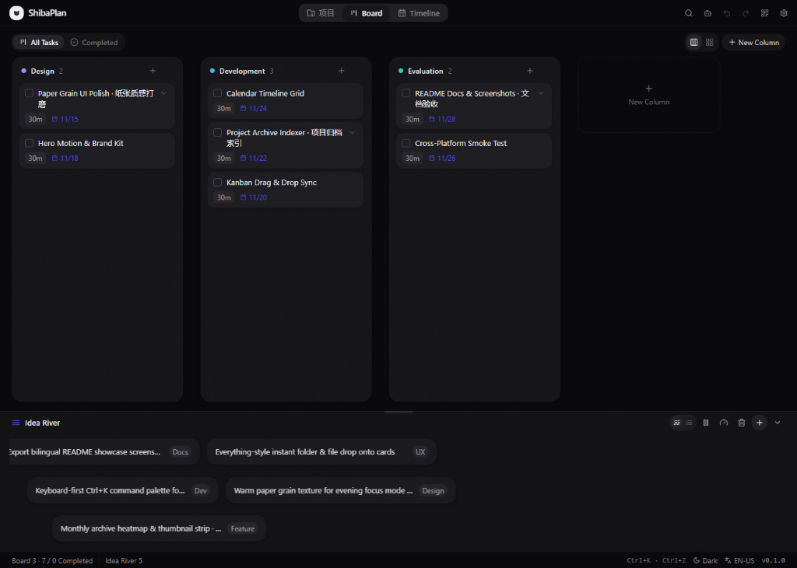

# 安装与快速上手

**ShibaPlan** 是一款面向设计师、开发者与评测人员打造的**本地优先（Local-First）个人节奏工作台**。基于 **Tauri 2.0 + React 18 + TypeScript** 构建，安装包轻量、冷启动迅速，所有核心数据默认以纯文本 JSON 与 Markdown 保存在你的本地磁盘中。



---

## 系统支持与安装

### 1. 下载桌面安装包

前往 [GitHub Releases](https://github.com/Wonvy/ShibaPlan/releases) 下载对应平台版本：

| 操作系统 | 安装包格式 | 说明 |
| :--- | :--- | :--- |
| **Windows 10 / 11 (x64)** | `.exe` (NSIS) / `.msi` | 内置 WebView2 拖放路径解析与 Seer 原生空格预览支持 |
| **macOS (Apple Silicon / Intel)** | `.dmg` / `.app.tar.gz` | 原生支持 Quick Look 与系统打开命令 |
| **Linux (x64)** | `.AppImage` / `.deb` | 通过 `xdg-open` 联动桌面文件管理器 |

### 2. 从源码构建（开发者）

本地开发需安装 **Node.js 20+** 与 **Rust 1.80+**（Windows 需安装 Visual Studio C++ 生成工具）：

```bash
git clone https://github.com/Wonvy/ShibaPlan.git
cd ShibaPlan
npm install

# 启动桌面开发模式（自动准备离线文档并热重载）
npm run tauri dev

# 构建生产安装包（自动打包内嵌中英文离线文档）
npm run tauri build
```

---

## 顶栏五大核心视图

启动 ShibaPlan 后，无边框顶部导航栏居中排列五个核心工作区，右侧提供命令面板、AI 排期、闪念捕获、撤销/重做、局域网扫码、帮助文档与设置入口：

1. **项目（Projects）**：三栏过往项目归档器，索引本地多个历史项目文件夹，支持 Everything 语法检索、格式统计图表与右侧内嵌文件浏览器。
2. **看板（Board）**：自定义任务列与自由点阵画布，支持本地文件/文件夹拖入生成快捷卡片、专注计时与优先级标星。
3. **时间（Timeline）**：按月视图排期，悬停查看单日负荷，支持从底部灵感流直接拖入某一天生成排期任务。
4. **备忘（Memos）**：支持多文件夹归类、Markdown 富文本记录，以及域名/SSL 证书/软件订阅/服务器到期倒计时提醒与一键续期。
5. **信息（Info）**：可自由拖拽缩放的自动化信息仪表盘，支持定时运行本地脚本、命令行、HTTP 接口或接收外部 Webhook 推送。

::: tip 托盘常驻与单实例保护
点击右上角关闭按钮 `×` 时，ShibaPlan 会隐藏至系统托盘以保持全局闪念快捷键（`Alt + Space`）与定时脚本持续可用。如需彻底退出，右键点击系统托盘图标选择**退出**即可。
:::

---

## 本地数据存储结构与多端同步

默认情况下，所有数据存放在用户文档目录 `~/Documents/ShibaPlan/`（Windows 下为 `%USERPROFILE%\Documents\ShibaPlan\`）：

```text
ShibaPlan/
├── shibaplan-data.json        # 核心工作区数据（看板、任务、灵感、备忘、信息卡片与设置）
├── project_archive_cache.json # 过往项目归档目录索引与缩略图缓存
├── backups/
│   └── workspace-YYYY-MM-DD.json  # 每日自动快照（自动滚动保留最近 7 天）
├── assets/
│   └── shot_*.png             # 剪贴板粘贴的截图文件
├── ideas/
│   └── *.md                   # 导出的灵感 Markdown 文件
├── scripts/                   # 信息看板内置保存的脚本文件
├── info-cache/
│   └── results.json           # 信息看板最近一次运行结果缓存
└── logs/
    └── shibaplan.log          # 自动轮转运行与崩溃诊断日志（单文件上限 2MB）
```

### 跨电脑同步（Windows + macOS）

打开 **设置 → 语言与数据**，将「本地数据 & Markdown 同步目录」指向 **OneDrive / iCloud Drive / Syncthing / Git 仓库** 下的任意文件夹并保存，即可在不经过任何第三方私有云的前提下实现多设备同步。

---

## 离线与在线文档访问

ShibaPlan 同时提供**内置离线文档**与**公网在线文档**两种查阅渠道，均完整支持**简体中文 / English** 一键切换与全文关键词检索：

- **软件内离线查询（无需联网）**：
  - 点击主界面右上角顶栏的 **文档图标（BookOpen）**；
  - 按 `Ctrl + K` 打开命令面板，搜索 `文档`、`API` 或 `Docs`；
  - 在 **设置 → 关于与更新**、**信息看板 → 标准协议说明** 或 **推送接收服务弹窗** 中点击「离线查阅文档」。
- **公网在线访问**：浏览器直接打开 `https://wonvy.github.io/ShibaPlan/`（或在软件内点击「打开在线文档」跳转至系统默认浏览器）。
- **局域网手机端访问**：开启局域网服务后，手机浏览器访问 `http://<电脑局域网IP>:18420/docs/` 同样可离线阅读完整文档。
