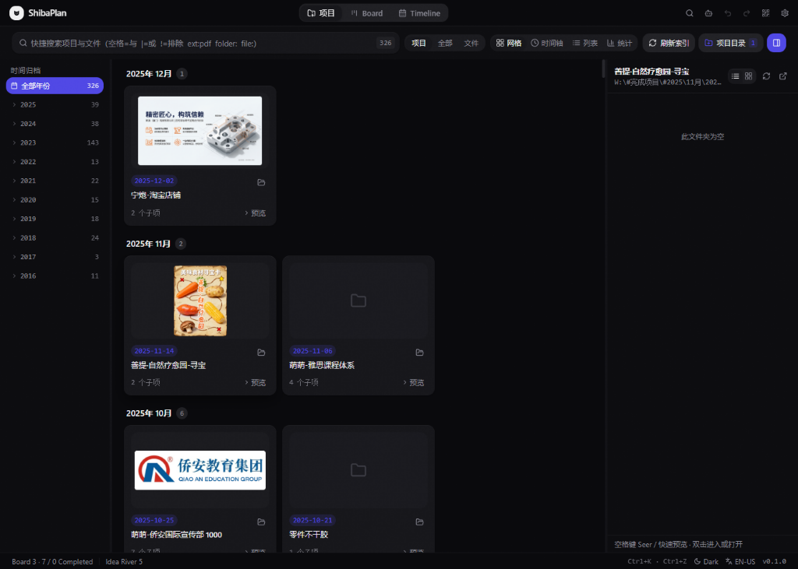
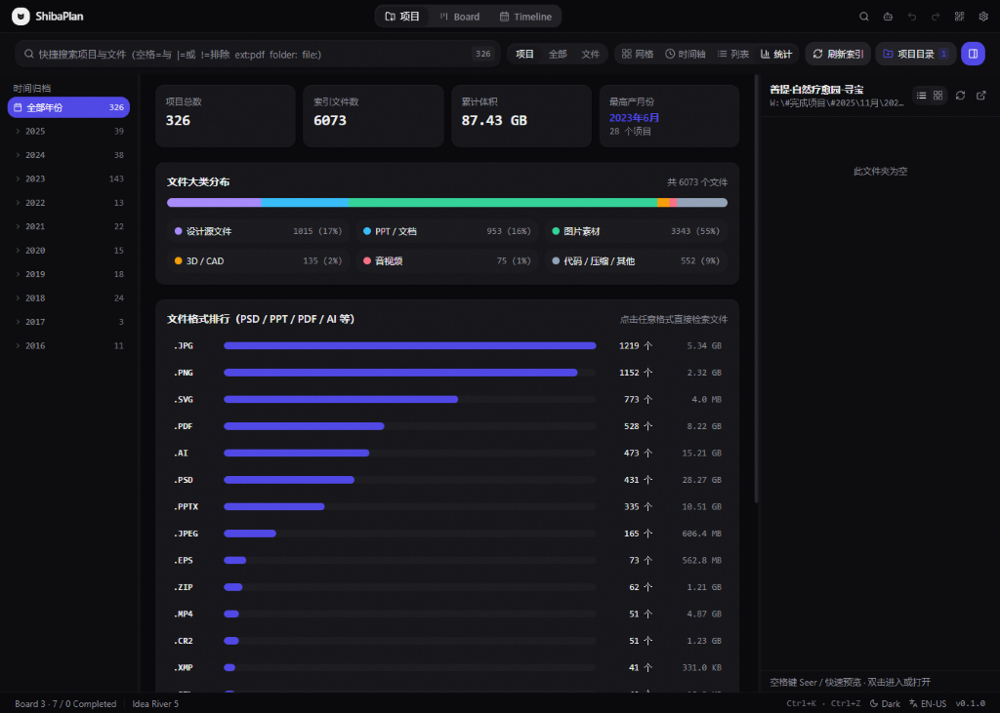

# 过往项目归档与检索

对于长期积累了成百上千个设计稿、工程目录、评测报告的用户，「项目」视图提供了一套**不改动原硬盘目录结构**的高速三栏归档与 Everything 级检索系统。

---

## 1. 添加归档根目录与增量缓存

1. 打开 **设置 → 项目目录**，点击选择文件夹（支持添加多个本地磁盘目录、外置移动硬盘或局域网映射盘 / NAS 路径，并可设置显示别名）。
2. ShibaPlan 会在后台多线程扫描目录树，提取项目封面缩略图与交付日期，并将索引持久化至本地 `project_archive_cache.json`。
3. **增量签名跳过**：二次扫描时通过目录子项数量、最大修改时间与体积签名对比，未发生变动的项目跳过深度遍历，实现冷启动零延迟加载。

---

## 2. 智能日期识别与真实完成日期推断

历史项目命名往往并不统一，ShibaPlan 内置多规则日期解析器与**加权月份聚类算法**：

- **兼容常见文件夹命名格式**：
  - `2025-10-10_新品包装`、`2025.10.10 发布会`、`2025年10月10日`
  - `20210913_主视觉`（8 位纯数字 `YYYYMMDD`）
  - `25-02-19 固件测试`、`250219_方案`（6 位简写 `YYMMDD`）
  - 父级年份/月份容器目录继承：如 `#2025/10月/0103_改版` 自动合并上下文年份。
- **真实完成日期推断（Weighted Month Clustering）**：
  - 当文件夹没有日期前缀，或因复制旧模板导致文件夹修改时间失真时，引擎会对项目内核心交付格式（如 `psd`、`ai`、`fig`、`blend`、`dwg`、`pptx`、`pdf`、`mp4`、`rs`、`ts` 等赋予 `3x` 权重，自动过滤 `~$`、`tmp`、`bak` 临时文件）按年月聚类，精准还原项目真实产出时间。
- 可在 **设置 → 项目目录** 中自由切换排序优先级：`名称日期优先`、`文件真实日期优先` 或 `仅按名称日期`。

---

## 3. Everything 级快捷搜索语法

在项目页按 `/` 或 `Ctrl + F` 聚焦顶部搜索框，支持实时组合过滤与关键词高亮：

| 语法示例 | 含义说明 |
| :--- | :--- |
| `包装 海报` | **与（AND）**：名称或路径同时包含 `包装` 和 `海报` |
| `KV \| 主视觉` | **或（OR）**：匹配 `KV` 或 `主视觉` |
| `!备份 !旧版` | **排除（NOT）**：剔除包含 `备份` 或 `旧版` 的结果 |
| `ext:psd;ai;pdf` | **按扩展名筛选**：匹配指定一种或多种后缀（分号分隔） |
| `folder:2025` | **仅匹配文件夹**：只显示目录条目 |
| `file:终稿` | **仅匹配单文件**：直接定位归档目录内的具体交付文件 |
| `year:2024` | **按年份过滤**：限定解析年份为 2024 年的项目 |
| `*评测?.pptx` | **通配符匹配**：`*` 匹配任意字符，`?` 匹配单个字符 |

---

## 4. 四种浏览视图与统计下钻

- **网格视图（Grid）**：保持封面图原始比例不裁剪，支持按住 `Ctrl + 鼠标滚轮` 无级缩放卡片尺寸。
- **时间轴视图（Timeline）**：按年份与月份分组纵向展开项目脉络。
- **紧凑列表（List）**：高密度展示路径、日期来源、子文件数与体积。
- **统计图表（Stats）**：自动汇总各格式文件排行（PSD / PPTX / PDF / AI / CAD / 视频 / 代码等）与历年/月度产出柱状图；**点击任意格式条即可一键下钻检索对应类型的全部历史文件**。

---

## 5. 右侧资源管理器与 Seer 空格预览

项目页左、中、右三栏宽度均可自由拖拽调节并自动记忆：
- 选中任意项目后，右侧面板直接内嵌展示该项目内部目录树（支持列表/图标视图切换、返回上级、在系统资源管理器中定位）。
- **空格键快速预览（`Space`）**：
  - Windows 下若已安装 [Seer](http://1218.io/)，ShibaPlan 会通过官方 Win32 `WM_COPYDATA (5000)` 协议零延迟唤起 Seer 原生预览 PSD、AI、CAD、Office、视频等专业格式；
  - 未安装 Seer 或在其他系统下，自动无缝回退至**内置高清图片灯箱 / 代码与文本快速预览窗**。
